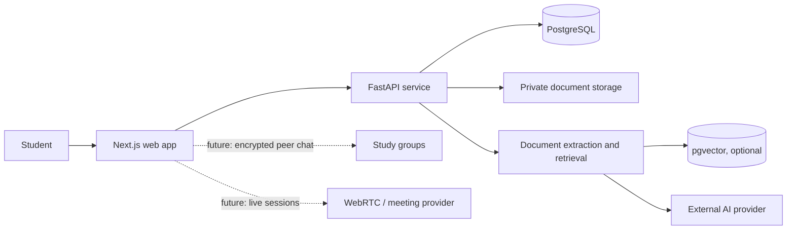

<div align="center">

# PADHAKU
### Your study material, turned into a smarter study loop.

**A student-first study workspace for notes, document analysis, AI-assisted revision, and collaborative learning.**

[Product overview](#what-is-padhaku) · [Features](#what-you-can-explore) · [Architecture](#architecture) · [Run locally](#run-locally) · [Roadmap](#roadmap)

</div>

---

## What is Padhaku?

Students keep lecture notes, PDFs, revision tasks, and study-group conversations in separate places. Padhaku brings that study loop into one workspace: organize material, ask questions grounded in your own sources, and turn what you learn into practice.

> **Product direction:** Padhaku is an AI-powered collaborative learning workspace that helps students make their own course material searchable, understandable, and easier to revise.

The project is under active development. The current repository is a **feature-rich prototype**: it includes a polished Next.js interface, interactive demo modules, sample learning data, an early AI route, a FastAPI scaffold, and a proposed PostgreSQL schema. Some screens currently demonstrate the intended experience with local or seeded data. Authentication, document ingestion/RAG, persistence, encrypted group chat, and live video still need end-to-end implementation before they can be described as production-ready.

## What you can explore

- **Study dashboard** with subject, revision, and activity views.
- **Notebooks and notes** with subject organization and editing interactions.
- **Document analyzer and AI tutor** that demonstrate the intended source-grounded study experience.
- **Quiz, flashcard, and planner modules** for active recall and revision.
- **Study group and room concepts** for peer learning and live sessions.
- **Target architecture** built around Next.js, FastAPI, and PostgreSQL with optional pgvector.

> **Prototype boundary:** sample content and interface interactions are not evidence of persistent multi-user behavior. The current E2EE and video interfaces are demonstrations, not production encryption or active calls. See [current state and limitations](docs/POC-and-current-state.md) for a code-based assessment.

## A student’s study loop

```text
Organize notes / add a course document
                ↓
Ask a question about selected study material
                ↓
Review an answer with source and page references
                ↓
Generate a quiz and practice weak topics
                ↓
Continue revision alone or with a study group
```

## Technology

| Layer | Current project / intended role |
|---|---|
| Web application | Next.js 15, React 19, TypeScript |
| UI | Tailwind CSS 4, custom components |
| Backend scaffold | Python 3, FastAPI |
| Data target | PostgreSQL; pgvector for embeddings where supported |
| AI integration | Server-side provider API (provider/model selection must be configured) |
| Privacy concepts | Browser Web Crypto and local search prototype; production E2EE is not yet implemented |
| Deployment target | Next.js on Vercel; FastAPI and managed PostgreSQL on a compatible host such as Render |

## Architecture



The intended first end-to-end workflow is account → notebook/document → document processing → cited question → quiz attempt. The prototype has not yet connected every step to authenticated APIs and durable storage.

## Run locally

### Prerequisites

- Node.js 20 or later and npm
- Python 3.11 or later for the FastAPI scaffold
- PostgreSQL with pgvector only if using the planned vector workflow

### Web app

```bash
npm install
npm run dev
```

Open [http://localhost:3000](http://localhost:3000).

### Backend scaffold

```bash
cd backend
python -m venv .venv
# Windows PowerShell: .venv\Scripts\Activate.ps1
# macOS/Linux: source .venv/bin/activate
pip install -r requirements.txt
uvicorn app.main:app --reload --port 8000
```

The backend currently exposes a health route and prototype AI/WebSocket routes; it is not yet a complete production API. Provider credentials must be supplied through environment variables. **Never put API keys in source code, browser variables, screenshots, or commits.**

## Roadmap

1. Secure accounts, sessions, database migrations, and per-user access controls.
2. Persist notebooks and notes; add private document upload and processing status.
3. Build real document extraction, retrieval, AI answers with verified citations, and saved conversations.
4. Generate and persist quizzes and review results from selected materials.
5. Add collaboration with an explicit privacy model; treat production E2EE and video as separate security/engineering milestones.

Read the [PRD](docs/PRD.md), [SRS](docs/SRS.md), [prototype assessment](docs/POC-and-current-state.md), and [gap analysis](docs/GAP-ANALYSIS.md) for requirements and implementation priorities.

## Security and privacy

- Do not use the demo login/OTP flow for real accounts.
- Do not upload sensitive documents to a deployment until access control, retention, and provider data handling are understood.
- Do not describe the current chat demo as end-to-end encrypted. Production E2EE requires real member key exchange, identity verification, key lifecycle handling, and independent review.
- Keep all provider/database/session secrets in the host’s secret manager or local ignored environment files.
- Report vulnerabilities privately to the project maintainer rather than opening an issue containing exploit details.

## Project documentation

- [Product Requirements Document](docs/PRD.md)
- [Software Requirements Specification](docs/SRS.md)
- [Proof of Concept and Current State](docs/POC-and-current-state.md)
- [Gap Analysis and Delivery Plan](docs/GAP-ANALYSIS.md)

## License

No license has been selected yet. Until one is added, the source is not granted an open-source license for reuse or redistribution.

<div align="center">

**PADHAKU — Learn together. Revise with purpose.**

</div>
