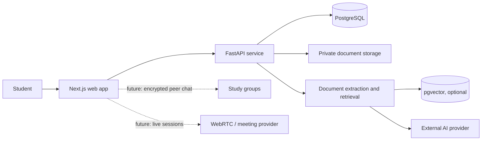

<div align="center">

# PADHAKU
### Your study material, turned into a smarter study loop.

**A student-first study workspace for notes, document analysis, AI-assisted revision, and collaborative learning.**

[Product overview](#what-is-padhaku) · [Features](#what-you-can-explore) · [Architecture](#architecture) · [Run locally](#run-locally) · [Roadmap](#roadmap)

</div>

---

## What is Padhaku?

Students keep lecture notes, PDFs, revision tasks, and study-group conversations in separate places. Padhaku brings that study loop into one workspace: organize material, ask questions grounded in your own sources, and turn what you learn into practice.

> **Product direction:** Padhaku is an AI-powered collaborative learning workspace that helps students make their own course material searchable, understandable, and easier to revise.

The project is under active development. The local core learning path uses FastAPI with persisted user accounts, private notes, PDF text extraction, and source-page retrieval. The initial frontend deployment is live, while responsive fixes pushed in commit `42bd388` are awaiting a Vercel rebuild because the project is not Git-connected. The production API is also not connected yet, so deployed login and data operations are unavailable. See [implementation status](docs/IMPLEMENTATION-STATUS.md) and the [testing report](docs/TESTING-REPORT.md) for verified boundaries.

## What you can explore

- **Study dashboard** with subject, revision, and activity views.
- **Notebooks and notes** with subject organization and editing interactions.
- **Document analyzer and AI tutor** that demonstrate the intended source-grounded study experience.
- **Quiz, flashcard, and planner modules** for active recall and revision.
- **Study group and room concepts** for peer learning and live sessions.
- **Target architecture** built around Next.js, FastAPI, and PostgreSQL with optional pgvector.

> **Prototype boundary:** sample content and interface interactions are not evidence of persistent multi-user behavior. The current E2EE and video interfaces are demonstrations, not production encryption or active calls. See [current state and limitations](docs/POC-and-current-state.md) for a code-based assessment.

## A student’s study loop

```text
Organize notes / add a course document
                ↓
Ask a question about selected study material
                ↓
Review an answer with source and page references
                ↓
Generate a quiz and practice weak topics
                ↓
Continue revision alone or with a study group
```

## Technology

| Layer | Current project / intended role |
|---|---|
| Web application | Next.js 15, React 19, TypeScript |
| UI | Tailwind CSS 4, custom components |
| Backend scaffold | Python 3, FastAPI |
| Data | SQLite for local setup; PostgreSQL through `DATABASE_URL` for deployment |
| Document Q&A | Page text extraction with per-user lexical retrieval and citations |
| Optional AI synthesis | NVIDIA-compatible provider via server-only environment variables; extractive answer works without a key |
| Privacy concepts | HttpOnly session cookie and owner-scoped API access; production group E2EE is not implemented |
| Deployment | Next.js frontend on Vercel; FastAPI and managed PostgreSQL deployment still required |

## Architecture



The implemented core path is account → personal notes/PDF → PDF page extraction → source-grounded question and citations. The quiz, planner, flashcard, group chat, and room modules still need deeper backend integration.

## Run locally

### Prerequisites

- Node.js 20 or later and npm
- Python 3.11 or later for the FastAPI scaffold
- PostgreSQL with pgvector only if using the planned vector workflow

### Web app

```bash
npm install
npm run dev
```

Open [http://localhost:3000](http://localhost:3000).

Copy `.env.example` to `.env.local` in the project root. The default `BACKEND_URL` expects FastAPI on port 8000.

### Backend scaffold

```bash
cd backend
python -m venv .venv
# Windows PowerShell: .venv\Scripts\Activate.ps1
# macOS/Linux: source .venv/bin/activate
pip install -r requirements.txt
uvicorn app.main:app --reload --port 8000
```

The local API creates `backend/padhaku.db` automatically. Open [http://localhost:8000/docs](http://localhost:8000/docs) for the interactive API reference. Without a model key, answers quote matching pages directly. If using provider synthesis, set `NVIDIA_API_KEY` in the backend process environment. **Never put API keys in source code, browser variables, screenshots, or commits.**

### Docker Compose

From the project root, copy `.env.example` to `.env` and run:

```bash
docker compose --env-file .env -f backend/docker-compose.yml up --build
```

This starts FastAPI and PostgreSQL. The compose password default is for local development only; do not reuse it for a public deployment.

## Verify changes

```bash
npm run build
cd backend
python -m unittest discover -s tests -v
```

The backend integration test uses a disposable SQLite database. Current local and hosted results are documented in the [testing report](docs/TESTING-REPORT.md).

## Deploy

- **Live frontend:** [padhaku-cbpi1spcx-anuj-yadav-s-projects7.vercel.app](https://padhaku-cbpi1spcx-anuj-yadav-s-projects7.vercel.app/)
- **Web:** import this repository into Vercel as a Next.js project and set `BACKEND_URL` to the deployed FastAPI service URL.
- **API + database:** use the included [Render blueprint](render.yaml), then set `FRONTEND_ORIGINS` to your deployed web origin and enable `COOKIE_SECURE=true`.
- **Optional AI:** configure `NVIDIA_API_KEY`, `NVIDIA_BASE_URL`, and `NVIDIA_MODEL` as server-side secrets/environment variables on the API service.
- PDF uploads are limited to 4 MB in this browser-to-API route to stay within common serverless request limits.
- SQLite is suitable for local demonstration only; use managed PostgreSQL for deployments where data must survive service replacement.

## Roadmap

1. Add managed database migrations, account recovery, CSRF/rate-limit protections, and operational monitoring.
2. Persist generated quizzes, planner tasks, flashcards, and tutor conversations.
3. Improve retrieval with embeddings/vector search and document-version-aware cache behavior.
4. Add collaboration with authenticated group membership and an explicit privacy model.
5. Treat production E2EE and live video as separate security/engineering milestones.

Read the [PRD](docs/PRD.md), [SRS](docs/SRS.md), [prototype assessment](docs/POC-and-current-state.md), and [gap analysis](docs/GAP-ANALYSIS.md) for requirements and implementation priorities.

## Security and privacy

- Do not use deployed login or data features until the API and database are configured and verified.
- Do not upload sensitive documents to a deployment until access control, retention, and provider data handling are understood.
- Do not describe the current chat demo as end-to-end encrypted. Production E2EE requires real member key exchange, identity verification, key lifecycle handling, and independent review.
- Keep all provider/database/session secrets in the host’s secret manager or local ignored environment files.
- Report vulnerabilities privately to the project maintainer rather than opening an issue containing exploit details.

## Project documentation

- [Product Requirements Document](docs/PRD.md)
- [Software Requirements Specification](docs/SRS.md)
- [Proof of Concept and Current State](docs/POC-and-current-state.md)
- [Gap Analysis and Delivery Plan](docs/GAP-ANALYSIS.md)
- [Implementation Status](docs/IMPLEMENTATION-STATUS.md)
- [Testing Report](docs/TESTING-REPORT.md)

## License

No license has been selected yet. Until one is added, the source is not granted an open-source license for reuse or redistribution.

<div align="center">

**PADHAKU — Learn together. Revise with purpose.**

</div>
